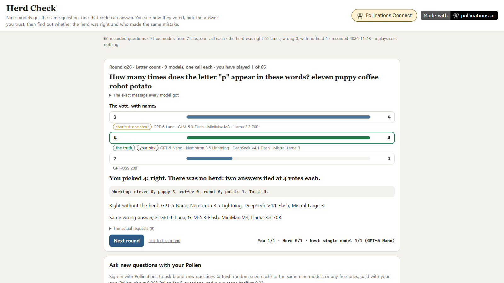

# Herd Check

[](https://pollinations.ai/?ref=badge)

**When the models agree, are they right?**

Nine free models from seven labs get the identical question, once each. Every question is one that code can answer: a weekday, a letter count, a product, a count, a reversed string, a classic trick question with new numbers. You see the vote with the names hidden, pick the answer you trust, then the reveal shows the truth, who said what, and who made the same mistake. Ask new questions with your own Pollen (BYOP).

**Live app:** https://patbing.github.io/herd-check/ · Pollinations quest [#19183](https://github.com/pollinations/pollinations/issues/19183)



## Why

The quest's post found that models from different labs give the same "controversial" take on humans. Agreement on an opinion can't be checked. Agreement on a fact can. So every question here has an answer computed by the same code that wrote it, and the page asks the question the post can't: when the herd agrees, is it right, and when models are wrong, are they wrong together?

## How it works

| Part | What happens |
|---|---|
| **The question** | `gen(family, seed, level)` in [`js/quiz.js`](js/quiz.js) builds the question, its truth, its working, and named shortcut answers (one day off, one short, the intuitive trick answer). Pure: the same seed gives the same question, so the recording stores only the seed. |
| **The message** | One user message, identical for every model: the question, then `Reply with one line only, in exactly this form: ANSWER: <...>`. A fresh random `seed` per call (Pollinations caches identical bodies). Reasoning models get `reasoning_effort: "low"` and `max_tokens: 1500`; the two one-shot models get `max_tokens: 100`. |
| **The answer** | `parse()` takes the last `ANSWER:` line, after removing `<think>` blocks. No such line, an empty reply, "5 or 6", or a failed request is *no answer*, which counts as not right. Nothing is guessed from the rest of the text. |
| **The herd** | The most common answer, if at least two models gave it and nothing tied with it. A *shared mistake* is two models giving the identical wrong answer. |
| **You** | Pick an answer, or "none of these is right", before the reveal. Scored against the herd and the best single model on the same rounds. |

## What the recordings show

66 rounds, recorded 2026-11-13, nine models, one call each (594 calls, 0.071 Pollen charged; `usage` accounts for 0.060, and failed calls are billed too). The main set came first: 42 rounds, seven of each kind. Because the herd never lost there, a harder set of 24 rounds followed (8 words to count letters in, 5-digit by 5-digit products, 30 numbers to count, 20 letters to reverse). Both are published and shown apart.

| | rounds | herd right | herd wrong | no herd | wrong answers | identical to another model's wrong answer | a named shortcut |
|---|---|---|---|---|---|---|---|
| Main set | 42 | 41 | **0** | 1 | 65 | 21 | 18 |
| Harder set | 24 | 24 | **0** | 0 | 54 | 4 | 9 |

| Model | kind | main set | harder set | no answer |
|---|---|---|---|---|
| DeepSeek V4.1 Flash | reasoning | 42/42 | 24/24 | 0 |
| GPT-5 Nano | reasoning | 41/42 | 24/24 | 0 |
| GPT-6 Luna | reasoning | 39/42 | 23/24 | 0 |
| MiniMax M3 | reasoning | 36/42 | 22/24 | 4 |
| GLM-5.3-Flash | reasoning | 36/42 | 23/24 | 0 |
| GPT-OSS 20B | reasoning | 33/42 | 17/24 | 1 |
| Nemotron 3.5 Lightning | reasoning | 33/42 | 12/24 | 17 |
| Mistral Large 3 | one-shot | 22/42 | 6/24 | 0 |
| Llama 3.3 70B | one-shot | 19/42 | 1/24 | 0 |

- **The herd was never wrong.** In 66 questions with a checkable answer, the most common answer of nine models was right 65 times. The other one (q26, the letter p in five words) was a 4 to 4 tie: four models said 4, the truth, and four said 3. Following the herd (65/66) beat seven of the nine models and tied GPT-5 Nano; only DeepSeek V4.1 Flash (66/66) did better.
- **Mistakes were mostly not shared, except on letter counting.** In the main set 21 of 65 wrong answers matched another model's wrong answer, 11 of them on letter counts (in q02, GPT-6 Luna, GLM-5.3-Flash and Mistral Large 3 all said 6 where the answer is 5). In the harder set only 4 of 54 did: the products, reversals and long counts went wrong in different ways for different models.
- **The two one-shot models failed together, but not the same way.** Llama 3.3 70B and Mistral Large 3 were both wrong on 35 questions and gave the identical wrong answer on 6 of them.
- **No answer is mostly a token limit.** Nemotron 3.5 Lightning used about 670 reasoning tokens a question in the main set and 970 in the harder set (counting the calls that answered), and ran out of `max_tokens: 1500` 17 times (an `HTTP 400` from the provider), MiniMax M3 4 times. All 22 no-answers in the recording are these limits; none is a format fault. They count as no answer, the same limit for every reasoning model.
- **The trick questions went 63 of 63**: these models know them. There are only three of them with new numbers, so two rounds (q06 and q18) came out as the same question with different seeds.
- **Two replies needed the parser to drop a stray `</think>`.** In h08 and h20 GLM-5.3-Flash wrote `ANSWER: <the truth>`, then its reasoning, a closing `</think>` with no opening tag, then the same answer again. Everything up to a closing `</think>` is now dropped, so both count as right; no other verdict in the recording changes. No round was re-recorded.

## Try it

- **Without an account:** play the recorded rounds, unseen ones first, closest votes first (most rounds are near-unanimous). Every judgment, the herd and every table are recomputed in your browser from the raw replies. "The actual requests" on each reveal shows the model, `max_tokens`, `seed`, tokens, cost and the raw reply. `?round=q26` or `?round=h17` links one round.
- **With your Pollen:** sign in, pick the question kinds and up to 12 free models (the nine are the default), pick level 2 or the harder level 3, and ask 1, 3 or 5 new questions. Each gets a new random seed, shown, so anyone can rebuild it. Under 0.01 Pollen for 5 questions on the nine; before each question the worst case for all its calls (and one retry each) is reserved, and the run stops before it could pass 0.03. Same pick-then-reveal; your live results are kept apart from the recording and never filled in from it.

## How Pollinations is used

| Purpose | Endpoint |
|---|---|
| Every answer | `POST https://gen.pollinations.ai/v1/chat/completions` |
| Model list, free vs paid-only, prices for the spend cap | `GET https://gen.pollinations.ai/v1/models` |
| Sign-in, BYOP | `<polli-connect>` from `@pollinations/ui` with this app's own App Key |

All network code is in [`js/net.js`](js/net.js); the engine in [`js/quiz.js`](js/quiz.js) has no DOM and no network.

## Privacy and safety

- Your `sk_` key comes from Pollinations Connect, which keeps it in this tab's sessionStorage. Herd Check's own code never stores, logs or sends it anywhere but `gen.pollinations.ai`.
- Model output is only ever inserted as text, never as HTML.
- Buttons that spend Pollen or pick an answer only respond to real clicks (`event.isTrusted`).
- No backend, no analytics, no build step. Herd Check keeps only your picks on recorded rounds, in this browser's localStorage.

## Run locally

```bash
python -m http.server 8134 --bind 127.0.0.1
```

Open http://127.0.0.1:8134/ (this address is registered on the App Key, so sign-in works locally too).

```bash
node --test tests/*.test.js
```

The tests pin the generators (500 seeds per kind: the truth checks out, no shortcut equals the truth), weekdays against known dates, the strict parser, the judge and shortcut labels, the herd (ties, single votes, no-answers in the denominator), the stats on a fixture, the request bodies, and that every recorded round rebuilds its exact message (`messagesSha`), with unique seeds and one call per model.

To record with your own key: `POLLINATIONS_KEY=sk_... node tools/record.mjs 7 0.15` (rounds per kind, then a Pollen cap; failed calls count at the worst case), and `node tools/record.mjs hard 6 0.11` for the harder set.

## License

MIT
